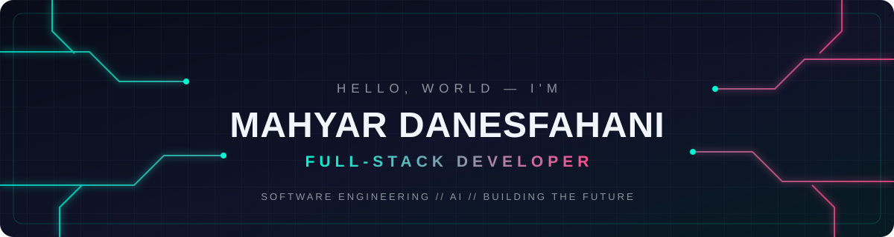

 

**FULL-STACK DEVELOPER · SOFTWARE ENGINEERING · AI EXPLORER**

*Learn deeply. Build thoughtfully. Ship consistently.*

---

## > whoami

I'm **Mahyar Danesfahani**, a Computer Engineering student and Full-Stack Developer interested in building useful software, exploring artificial intelligence, and understanding how systems work under the hood.

- Building web applications and software projects
- Exploring AI, automation, and intelligent agents
- Interested in backend engineering, clean architecture, and developer tools
- Always learning by turning ideas into working projects

## > tech_stack

  

<b>Tech stack — text view</b>

| Area | Technologies |
|---|---|
| Languages | Python, Java, JavaScript, PHP, C/C++ |
| Web | HTML, CSS, Laravel |
| Backend & Frameworks | Django, Laravel, aiogram |
| Tools | Git, GitHub, Linux |
| Exploring | AI engineering, automation, software architecture, networking |

## > selected_projects

<table>
<tr>
<td width="50%" valign="top">

### [dark-shell-portfolio](https://github.com/MahyarDanesfahani/dark-shell-portfolio)

A personal portfolio project.

</td>
<td width="50%" valign="top">

### [cyber-quest](https://github.com/MahyarDanesfahani/cyber-quest)

A browser-based code-breaking mini game.

</td>
</tr>
<tr>
<td width="50%" valign="top">

### [building-manager](https://github.com/MahyarDanesfahani/building-manager)

A software project in the building-management domain.

</td>
<td width="50%" valign="top">

### [Compiler_Project](https://github.com/MahyarDanesfahani/Compiler_Project)

A compiler-focused project.

</td>
</tr>
</table>

## > github_analytics

 

 

### > automated_metrics

The metrics image below is refreshed automatically by GitHub Actions.

  

## > در یک نگاه | Persian

من **مهیار دانش‌فراهانی**، دانشجوی مهندسی کامپیوتر و توسعه‌دهنده فول‌استک هستم. به ساخت نرم‌افزارهای کاربردی، مهندسی نرم‌افزار و هوش مصنوعی علاقه دارم.

- توسعه پروژه‌های نرم‌افزاری و وب
- تجربه کار با Python، Java، JavaScript، PHP و Laravel
- علاقه‌مند به هوش مصنوعی، اتوماسیون و طراحی معماری نرم‌افزار
- یادگیری از طریق ساخت پروژه‌های واقعی و حل مسئله

## > contact

 

**BUILD · BREAK · LEARN · REPEAT**

